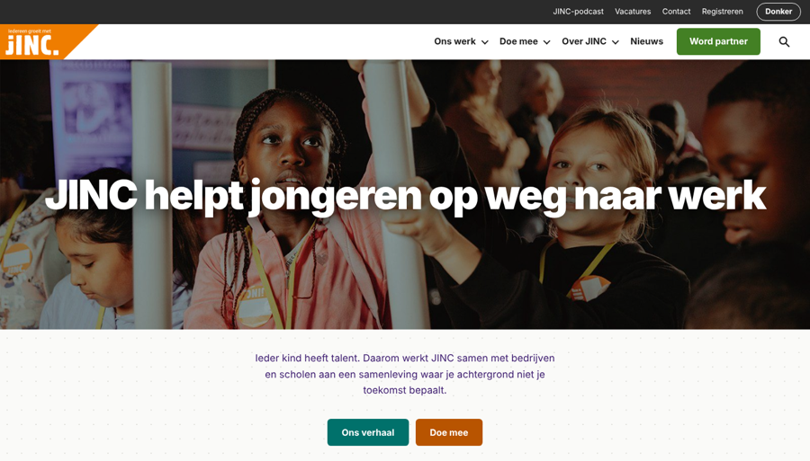
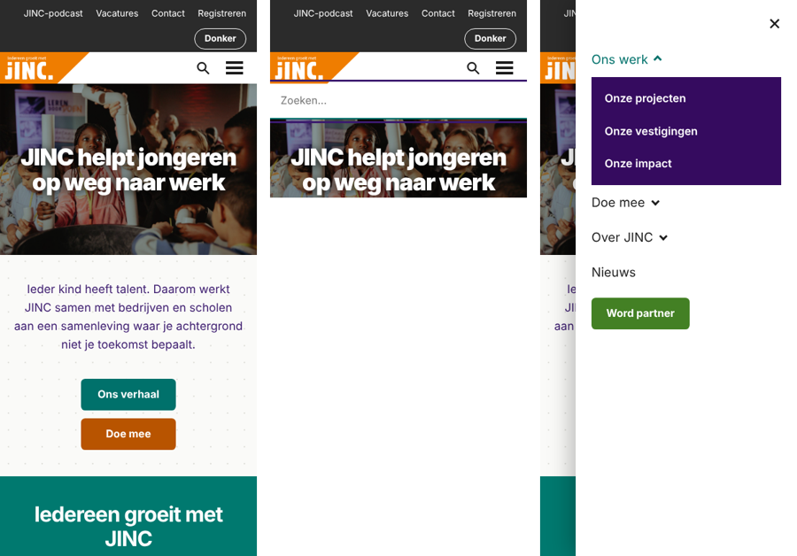
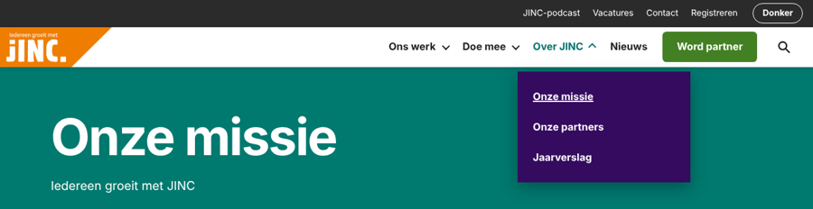

# Procesverslag

> Dit is een sjabloon in dezelfde opbouw als je vorige procesverslag. De technische uitleg is ingevuld; alles wat over **jouw** proces, tests en gesprekken gaat moet je zelf invullen. Verwijder dit blokje als je klaar bent.

## Jij

### Auteur:
Firdaouss Yakubi

#### Je startniveau:
Blauw 

#### Je focus:
Responsive

## Je website
https://www.jinc.nl/

https://www.jinc.nl/ons-werk/onze-missie/

### Je opdracht:
Nabouwen van twee pagina's van JINC (homepage en "Onze missie") op basis van mijn breakdown.

#### Screenshots (small screen):
(voeg je eigen screenshots toe in een map `readme-images/`)

## Toegankelijkheidstest 1/2 (week 1)

## Toegankelijkheidstest 1/2 (week 1)

Voor mijn toegankelijkheidstest heb ik gekeken naar de website van JINC. Hierbij heb ik vooral gelet op hoe toegankelijk de website is voor verschillende gebruikers en welke onderdelen eventueel verbeterd kunnen worden.

### Screenreader
Bij het bekijken van de website viel mij op dat niet alle knoppen en links even duidelijk zijn benoemd. Zo heeft de zoekknop geen duidelijke naam en is de structuur van sommige koppen niet helemaal logisch. Dit kan verwarrend zijn voor mensen die een screenreader gebruiken.

**Wat neem ik mee:** Ik wil proberen mijn HTML zo logisch mogelijk op te bouwen en duidelijke namen te gebruiken voor knoppen en links.

### Muis en toetsenbord
Wat mij vooral opviel, was de footer op mobiel. De onderdelen die je kunt uitklappen werken niet goed, waardoor sommige links moeilijk bereikbaar zijn. Ook is het belangrijk dat je zonder muis door een website kunt navigeren.

**Wat neem ik mee:** Ik wil hier tijdens het bouwen rekening mee houden en proberen mijn knoppen en menu's zo toegankelijk mogelijk te maken.

### Motoriek
Voor mensen die moeite hebben met kleine bewegingen, kunnen knoppen die dicht op elkaar staan lastig zijn. Vooral bij de socialmedia-iconen en de footerlinks kan dit een probleem zijn.

**Wat neem ik mee:** Ik wil waar mogelijk voldoende ruimte houden tussen knoppen en links, zodat deze makkelijker aan te klikken zijn.

### Visueel
Bij het bekijken van de website heb ik vooral gelet op de leesbaarheid. Sommige teksten staan over afbeeldingen heen, waardoor contrast belangrijk is. Ook moet de website overzichtelijk blijven op kleinere schermen.

**Wat neem ik mee:** Ik wil proberen rekening te houden met contrast, lettergroottes en de leesbaarheid op mobiel.

### Reflectie
Door deze toegankelijkheidstest ben ik me er meer van bewust geworden dat er bij het bouwen van een website meer komt kijken dan alleen het uiterlijk. Eerlijk gezegd ben ik op dit moment vooral bezig met het goed namaken van de website en vind ik dat al best een uitdaging.

Ik ga daarom niet alle verbeterpunten uit de toegankelijkheidstest kunnen toepassen, maar wil ze wel zoveel mogelijk in mijn achterhoofd houden tijdens het bouwen. Waar het lukt, probeer ik er rekening mee te houden. Voor mij is het vooral belangrijk dat ik begrijp waarom toegankelijkheid een rol speelt en dat ik hier bewuster mee omga.

## Breakdownschets

(https://www.figma.com/board/s3q9VkvcRvre2P3KDvvRTi/breakdown?node-id=0-1&t=3j0zgu3aXrDLMvMx-1
)

# Voortgang 1, 2 en 3

## Voortgang 1 – Eerste schetsen en breakdownsheet

**Wat ging goed?**

Tijdens voortgang 1 was ik vooral bezig met het analyseren van de taxiwebsite van Bolt. Ik had zelf schetsen gemaakt voor mijn breakdownsheet en wilde graag snel vooruitgang boeken. Ik had in ieder geval een begin gemaakt en dacht dat ik hiermee een goede basis had.

**Wat ging lastig?**

Ik wilde het mezelf makkelijker maken door mijn schetsen samen met een afbeelding van de huidige website te uploaden naar AI. Ik dacht dat AI de onderdelen wel voor mij kon omcirkelen, zodat ik niet alles opnieuw hoefde te doen. Achteraf was dit niet zo slim, omdat ik mijn instructies niet duidelijk genoeg had gegeven en de uitwerking daardoor veel fouten bevatte.

Tijdens voortgang 1 kwam ik hierachter. Dit vond ik best demotiverend, omdat ik dacht dat ik al verder was dan daadwerkelijk het geval was.

**Agenda en verslag van de meeting**

Tijdens de meeting werd duidelijk dat mijn breakdownsheet nog niet goed genoeg was uitgewerkt en dat er fouten in zaten. Ik moest kritischer kijken naar mijn eigen werk en niet zomaar vertrouwen op wat AI voor mij genereert.

Mijn belangrijkste leerpunt was dat AI een handig hulpmiddel kan zijn, maar dat ik zelf verantwoordelijk blijf voor het controleren en begrijpen van mijn werk.

## Voortgang 2 – Motivatie en vastlopen

**Wat ging goed?**

Na de eerste voortgang heb ik geprobeerd mezelf opnieuw te motiveren en verder te werken aan de website van Bolt. Ondanks dat ik het vak spannend vind, wilde ik het niet zomaar opgeven.

**Wat ging lastig?**

Ik merkte dat ik steeds meer tegen het werken aan de website begon op te zien. Ik was opnieuw enorm zenuwachtig en had moeite om mezelf ertoe te zetten. Mijn gezondheid was op dat moment ook niet optimaal, waardoor alles nog wat zwaarder voelde.

Hierdoor bleef ik veel treuzelen en stelde ik het werk steeds uit. Uiteindelijk ben ik ook niet komen opdagen bij voortgang 2. Ik merkte dat ik niet alleen vastliep op de technische kant van de opdracht, maar ook op mijn eigen spanning en motivatie.

**Agenda en verslag van de meeting**

Bij voortgang 2 was ik niet aanwezig, dus er heeft voor mij geen voortgangsgesprek plaatsgevonden.

Wel was dit voor mij een moment waarop ik besefte dat ik iets moest veranderen. Ik wilde niet blijven vastlopen en had het gevoel dat ik met een andere website misschien weer meer motivatie zou krijgen.

## Voortgang 3 – Overstap naar JINC en opnieuw beginnen

**Wat ging goed?**

In het weekend na voortgang 2 heb ik besloten om over te stappen van Bolt naar JINC. Omdat ik zelf veel actief ben in het onderwijs, leek het mij leuker om aan een website te werken waar ik ook echt affiniteit mee heb. Ik hoopte dat ik hierdoor meer motivatie zou krijgen.

Dat bleek gelukkig ook zo te zijn. Ik ben samen met Samya gaan zitten en zij heeft mijn breakdownsheet gecontroleerd. Dit hielp mij enorm, omdat ik hierdoor meer zekerheid kreeg over wat ik aan het doen was.

Vervolgens kon ik beginnen met het opbouwen van de structuur van mijn website. Ik merkte dat ik weer wat meer motivatie kreeg en daadwerkelijk stappen begon te zetten.

**Wat ging lastig?**

Het proces ging absoluut niet vanzelf. Het was echt veel duwen en trekken. Ik heb regelmatig hulp nodig gehad van AI en medestudenten om verder te komen.

Wat ik vooral lastig vind, is dat ik door de spanning rondom dit vak moeite heb om informatie te onthouden. Soms begrijp ik iets op het moment zelf, maar wanneer ik er later zelfstandig mee verder wil, ben ik alweer vergeten hoe het precies werkt.

Ik probeer daarom niet alleen oplossingen over te nemen, maar ook te begrijpen wat ik aan het doen ben en waarom bepaalde code werkt. Dat kost mij soms meer tijd dan ik zou willen.

**Agenda en verslag van de meeting**

Mijn belangrijkste aandachtspunt voor deze voortgang was om te laten zien dat ik opnieuw was begonnen met een website die beter bij mij past. Daarnaast wilde ik mijn verbeterde breakdownsheet en de eerste structuur van mijn JINC-website bespreken.

Door de hulp van Samya en mijn medestudenten kreeg ik meer overzicht en kon ik gerichter verder werken.

## Algemene reflectie

Als ik terugkijk op deze drie voortgangsmomenten, merk ik vooral hoeveel invloed spanning en onzekerheid op mijn manier van werken hebben. Ik vind dit vak lastig en merk dat ik mezelf soms behoorlijk in de weg zit. Daardoor stel ik dingen uit, terwijl ik eigenlijk wel graag vooruit wil.

De overstap naar JINC heeft mij geholpen om opnieuw motivatie te vinden. Ik ben er nog niet en het kost mij nog steeds veel moeite, maar ik probeer op mijn eigen tempo door te werken en vooral te begrijpen wat ik maak.

Mijn grootste leerpunt tot nu toe is dat ik niet alles zo snel mogelijk moet willen doen. Juist door haast te maken en te veel op AI te vertrouwen, heb ik in het begin fouten gemaakt die ik achteraf weer moest herstellen. Ik wil daarom meer aandacht besteden aan het zelf begrijpen, controleren en stap voor stap opbouwen van mijn code.

## Toegankelijkheidstest 2/2

(invullen: bevindingen van je testpartner en wat je daarna hebt verbeterd)

## Eindgesprek (week 5)

### Je uitkomst - karakteristiek screenshots:

### Dit ging goed/Heb ik geleerd:
Het is mij gelukt om de homepage en missiepagina van JINC na te bouwen met HTML, CSS en JavaScript. Ik ben echt mobile first begonnen en heb geprobeerd alles responsive te maken, zodat de website op zowel mobiel als desktop goed werkt. Ook heb ik geleerd hoe ik met breakpoints het hamburgermenu kan veranderen naar een normale navigatiebalk.

Wat ik echt een uitdaging vond, waren de uitklapbare onderdelen in het menu en de footer. Hiervoor heb ik 
 en 
 gebruikt. Vraag me niet om het morgen opnieuw te maken, haha, want het heeft me echt veel moeite gekost.

Daarnaast heb ik geprobeerd rekening te houden met toegankelijkheid, zoals een skiplink, duidelijke focusranden en het bedienen van menu's met een toetsenbord. Ook heb ik een dark en light mode gemaakt, een nieuwsbriefpop-up toegevoegd en gewerkt met animaties.

### Dit was lastig/Is niet gelukt:
Dit was lastig / Is niet gelukt:

Wat ik tijdens het bouwen vooral lastig vond, was JavaScript. HTML en CSS kon ik na een tijdje steeds beter volgen, maar bij JavaScript had ik vaak het gevoel dat ik opnieuw moest beginnen.

Soms begreep ik iets op het moment dat het werd uitgelegd, maar zodra ik het later zelf moest toepassen, wist ik niet meer precies hoe het werkte of ging het mis en werkte het niet meer. Ik heb daarom echt van alle kanten hulp gezocht. Ik heb medestudenten gevraagd, kennissen om hulp gevraagd en AI gebruikt wanneer ik ergens niet uitkwam. Daarbij probeerde ik ook steeds te begrijpen wat ik precies aan het doen was, in plaats van alleen maar code over te nemen. Dat lukte niet altijd even goed, maar ik heb wel mijn best gedaan om er iets van te leren.

Wat ik ook lastig vond, was dat ik soms zo lang bezig was met één onderdeel dat ik het overzicht verloor over wat er nog moest gebeuren. Hierdoor heb ik niet alles kunnen afronden zoals ik had gewild.

Ondanks dat niet alles is gelukt, ben ik wel blij met wat ik uiteindelijk heb gemaakt. Het heeft mij veel moeite gekost, maar ik heb geprobeerd om door te zetten, hulp te zoeken en vooral te begrijpen hoe alles werkt.

Voor een volgende keer wil ik niet treuzelen en te onzeker zijn ik merk dat ik enorm gedemotiveerd ben omdat ik dit vak niet leuk vindt. beter plannen en blijven oefenen, zodat ik minder afhankelijk word van hulp en steeds meer zelfstandig kan maken.

## Bronnenlijst

Bronnen voor de technieken in de code (voeg je eigen bronnen toe en vul aan wat je zelf hebt gebruikt):

Bronnen voor de technieken in de code (voeg je eigen bronnen toe en vul aan wat je zelf hebt gebruikt):
https://www.w3schools.com/tags/tag_select.asp

https://developer.mozilla.org/en-US/docs/Web/CSS/animation-timing-function*/

https://css-tricks.com/a-complete-guide-to-calc-in-css/*/

https://www.javatpoint.com/how-to-center-a-button-in-css

https://codepen.io/shooft/pen/BarqVdR*/

https://www.w3schools.com/howto/howto_css_list_without_bullets.asp */

https://developer.mozilla.org/en-US/docs/Web/HTML/Element/input/email*/

https://developer.mozilla.org/en-US/docs/Web/CSS/box-shadow*/

https://stackoverflow.com/questions/8287447/create-a-white-rgba-css3*/

https://www.w3.org/TR/css-multicol-1/*/

https://codepen.io/shooft/pen/yLEwVXm*/

https://www.handleidinghtml.nl/css/eigenschappen/white-space/beschrijving.html*/

https://stackoverflow.com/questions/25125793/

html-css-display-text-and-wrap-it-propertly-in-two-columns-and-a-single-row*/

https://developer.mozilla.org/en-US/docs/Web/CSS/Media_Queries/Using_media_queries*/

https://kinsta.com/nl/blog/responsive-webdesign/*/

bron:https://fsymbols.com/copyright/

bron:https://developer.mozilla.org/en-US/docs/Web/HTML/Element/details-->

bron:https://codepen.io/ahmadbassamemran/pen/rNjMXqg -->

https://www.freecodecamp.org/news/span-html-how-to-use-the-span-tag-with-css/-->
bron:https://www.w3schools.com/html/html_quotation_elements.asp -->

https://developer.mozilla.org/en-US/docs/Web/CSS/scroll-snap-type-->
bron:https://codepen.io/simevidas/pen/PJMENp-->

<https://developer.mozilla.org/en-US/docs/Web/HTML/Element/video> -->
						<!-- <https://www.w3schools.com/html/html5_video.asp> -->
						<!-- <https://yt5s.io/en1/youtube-to-mp4> -->

/*bron: https://www.w3schools.com/howto/howto_css_list_without_bullets.asp */

/*bron:https://www.handleidinghtml.nl/css/eigenschappen/white-space/beschrijving.html*/
/*bron:https://stackoverflow.com/questions/25125793/html-css-display-text-and-wrap-it-propertly-in-two-columns-and-a-single-row*/

/*bron:https://codepen.io/shooft/pen/BarqVdR*/

Foto's, illustraties en logo's zijn van JINC (jinc.nl) en alleen gebruikt voor deze schoolopdracht.

